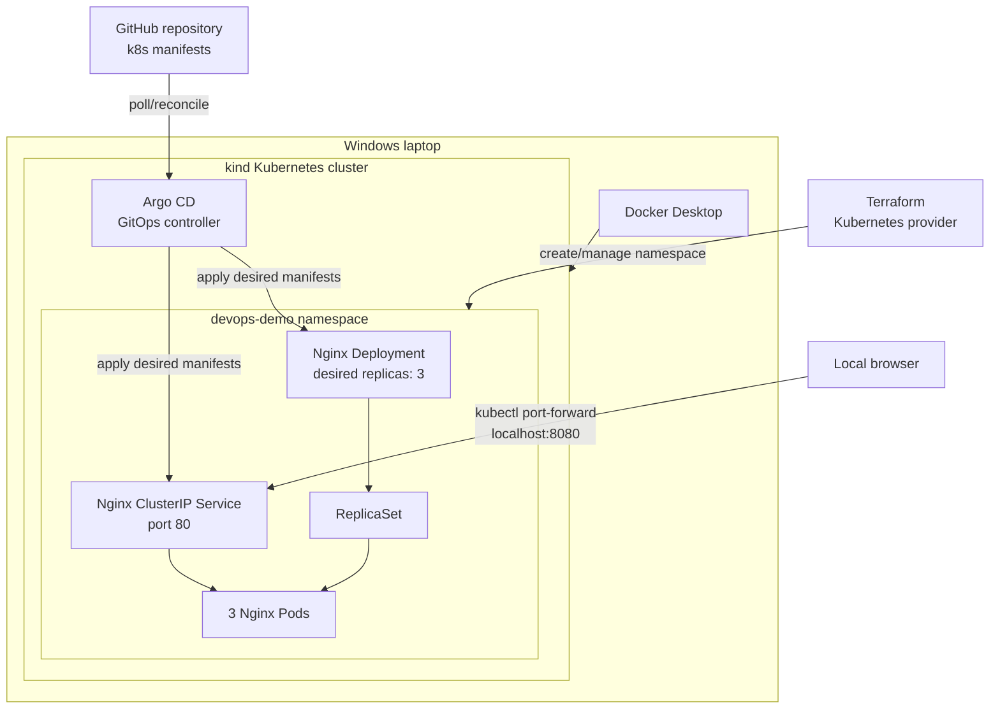

# Kubernetes GitOps Automation with Terraform, Argo CD and Nginx

**Project type:** DevOps / Platform Engineering portfolio lab  
**Environment:** Windows, Docker Desktop, kind (local Kubernetes)  
**Repository:** https://github.com/kelechiogboi2018/kubernetes-terraform-gitops-project  
**Author:** Kelechi Ogboi, BSc Computer Science, MSc Applied Data Science

## Project overview

This project demonstrates Infrastructure as Code (IaC) and GitOps continuous delivery on a local Kubernetes cluster. Terraform provisions a dedicated Kubernetes namespace (`devops-demo`), while Argo CD monitors Kubernetes manifests in GitHub and reconciles an Nginx Deployment and Service into that namespace. Kubernetes maintains the desired replica count and replaces deleted Pods automatically.

The cluster is **local**, created with kind and hosted by Docker Desktop; this project does **not** provision Amazon EKS or AWS infrastructure.

## Problem statement

Manual Kubernetes deployments introduce configuration drift, inconsistent changes and repetitive operational work. Teams need reproducible infrastructure, a version-controlled source of truth for application configuration, and automated reconciliation and workload recovery.

## Objectives

1. Create and operate a local Kubernetes cluster using kind.
2. Provision a dedicated namespace through Terraform.
3. Deploy Nginx from GitHub manifests through Argo CD.
4. Enable automatic synchronization of Git changes.
5. Demonstrate declarative scaling from five Nginx replicas to three.
6. Demonstrate Kubernetes self-healing after manual Pod deletion.
7. Investigate and recover from a Docker Desktop startup failure.

## Architecture


[Download editable vector architecture diagram](architecture-diagram.svg)

### Logical deployment flow



> **Scope:** A Kubernetes namespace is a logical resource boundary, not an AWS VPC, VM or control plane. The Argo CD controller runs in its own `argocd` namespace. Terraform manages the namespace; Argo CD manages Nginx application resources. The infographic is a conceptual summary; the Mermaid diagram shows the resource relationships.

## Technology stack

| Tool | Role |
|---|---|
| Windows PowerShell | Local operations and verification |
| Docker Desktop | Container runtime host for the kind cluster |
| kind | Local Kubernetes cluster (`kind-devops-lab` context) |
| Kubernetes | Deployments, ReplicaSets, Pods, Services, namespaces |
| Terraform | Kubernetes namespace provisioning and state tracking |
| Argo CD | GitOps application reconciliation and automatic sync |
| GitHub | Version-controlled Kubernetes manifests |
| Nginx | Demonstration web workload |

## Infrastructure provisioning

From the repository's `terraform` directory:

```powershell
cd C:\Users\Hp\kubernetes-gitops-project\terraform
terraform init
terraform fmt
terraform validate
terraform plan
terraform apply
terraform state list
kubectl get namespaces
```

Terraform-managed resource verified:

```text
kubernetes_namespace_v1.devops_demo
```

The plan subsequently reported:

```text
No changes. Your infrastructure matches the configuration.
```

Illustrative namespace resource (refer to the actual repository for the authoritative Terraform configuration):

```hcl
resource "kubernetes_namespace_v1" "devops_demo" {
  metadata {
    name = "devops-demo"
  }
}
```

**Important:** The Kubernetes provider must point to the intended `kind-devops-lab` context before applying changes. Do not run `terraform destroy` while preserving this lab.

## GitOps application deployment

1. Install Argo CD into the `argocd` namespace of the kind cluster.
2. Access the Argo CD UI through a local port forward:

   ```powershell
   kubectl port-forward svc/argocd-server -n argocd 8081:443
   ```

3. Configure application `nginx-gitops` with the GitHub repository above, revision `main`, source path `k8s`, destination cluster `in-cluster` and namespace `devops-demo`.
4. Ensure Nginx manifests target the intended namespace (avoid a conflicting hard-coded `metadata.namespace`).
5. Enable Argo CD Auto-Sync and verify the application becomes **Healthy** and **Synced**.
6. Verify the Deployment and Service:

   ```powershell
   kubectl get deployment,service,pods -n devops-demo
   ```

7. Access Nginx from the laptop:

   ```powershell
   kubectl port-forward -n devops-demo svc/nginx-web 8080:80
   ```

   Open `http://localhost:8080` while the forwarding session remains running.

### Namespace migration and cleanup

Nginx originally ran in `default`. After deploying the application to `devops-demo`, Argo CD showed the old Deployment and Service as requiring pruning. The obsolete `nginx-web` Deployment and Service were deleted specifically from `default`, preserving the unrelated `job-web` resources. A subsequent Argo CD screenshot showed **Healthy**, **Synced**, **Sync OK** and Auto-Sync enabled.

## Testing and evidence

### Test A: GitOps scaling

**Action:** Update `k8s/nginx-deployment.yaml` on GitHub from `replicas: 5` to `replicas: 3` and commit to `main`.

**Expected:** Argo CD detects the changed desired state and reconciles the Deployment without a manual `kubectl apply` or `terraform apply`.

**Observed:** PowerShell output showed:

```text
NAME        READY   UP-TO-DATE   AVAILABLE
nginx-web   3/3     3            3
```

This confirms the desired scale was reached. The GitHub/Argo CD workflow was the intended trigger; preserve the commit and Argo CD sync history as supporting evidence of the exact reconciliation path.

### Test B: Kubernetes self-healing

**Action:** Delete one Nginx Pod in `devops-demo`:

```powershell
kubectl get pods -n devops-demo
kubectl delete pod nginx-web-f7dd7d867-jdkxm -n devops-demo
kubectl get pods -n devops-demo
kubectl get deployment nginx-web -n devops-demo
```

**Observed:** Kubernetes reported the selected Pod deleted and created a new Pod ending `mxs9p`. The Deployment returned to **3/3 Ready**, with three running Pods.

**Interpretation:** The ReplicaSet/Deployment controllers restored the requested replica count. This is **Kubernetes workload self-healing**, distinct from Argo CD's optional self-heal setting for configuration drift.

### Test C: Service connectivity

The `nginx-web` Service was verified in `devops-demo` as a `ClusterIP` Service on TCP port 80. Local access used `kubectl port-forward`; the ClusterIP is not a public internet endpoint.

### Suggested evidence screenshots

Place original screenshots in an `evidence/` directory and reference them in this README:

- Terraform `state list` and `plan` showing `devops-demo` and no drift.
- Argo CD `nginx-gitops` showing Healthy and Synced.
- Kubernetes Deployment with 3/3 replicas.
- Pod deletion and replacement (`jdkxm` to `mxs9p`).
- Docker Desktop error and subsequent successful `docker ps` / `kubectl` checks.

## Troubleshooting: Docker Desktop and Kubernetes API outage

### Symptoms

During the self-healing exercise, `kubectl` requests failed with:

```text
Unable to connect to the server: net/http: TLS handshake timeout
```

The local Kubernetes API endpoint was `127.0.0.1:55827`. Docker CLI checks then showed:

```text
Error response from daemon: Docker Desktop is unable to start
```

### Investigation

- Attempted `kubectl cluster-info` and Pod queries; Kubernetes API access timed out.
- Ran `docker ps` and `docker info`; the Docker daemon was initially unavailable.
- Investigated Docker Desktop startup and its dependency on the local container runtime.
- After recovery, verified that the kind control-plane container was `Up` and Kubernetes Pod queries succeeded.

### Recovery and verification

The user restored Docker Desktop availability and then verified:

```powershell
docker ps
kubectl get pods -n devops-demo
kubectl get deployment nginx-web -n devops-demo
```

The control-plane container was running again; Nginx returned to **3/3 Ready**. Some existing Pods showed one restart following the interruption.

**Root-cause confidence:** Docker Desktop unavailability was a confirmed proximate cause of the Kubernetes API outage. The underlying reason Docker Desktop failed to start (such as WSL, resource pressure or another startup issue) was **not conclusively diagnosed**. Do not present it as a proven WSL or memory failure.

**Safety:** Avoid resetting Docker Desktop, unregistering WSL distributions, deleting the kind cluster or destroying Terraform resources during initial troubleshooting; these may remove the lab environment.

## Security and operational considerations

- **Namespace boundaries:** `devops-demo` helps organize resources, but namespaces alone do not enforce network isolation. Use RBAC, NetworkPolicies and quotas where appropriate.
- **Least privilege:** Limit Argo CD and Kubernetes identities to required permissions; use scoped access for production deployments.
- **Credentials:** Never commit kubeconfig credentials, tokens, Terraform state containing secrets or Argo CD admin passwords to GitHub.
- **Git controls:** Protect `main` with reviews and automated validation for production workflows.
- **Local access:** Port forwarding is suitable for development; use authenticated ingress and TLS for production access.
- **Supply chain:** Pin trusted container image versions/digests and scan images and manifests.
- **State management:** Use a secured remote Terraform backend and state locking for collaborative or production deployments; this lab used local Terraform state.
- **Pruning:** Enable automated resource pruning only after understanding the deletion impact. The namespace migration deliberately verified resources before removing obsolete objects.

## Lessons learned

1. **Separate responsibilities:** Terraform provisions the namespace, Argo CD reconciles application manifests, and Kubernetes maintains workload availability.
2. **Git as desired state:** Application changes can be reviewed, committed and automatically deployed through GitOps.
3. **Reconciliation differs from recovery:** Argo CD syncs configuration; Kubernetes controllers replace deleted Pods.
4. **Platform dependencies matter:** A local cluster depends on Docker Desktop being available.
5. **Migrations need cleanup:** Moving resources between namespaces can leave old objects behind when pruning is disabled.
6. **Verify before deleting:** Inspect namespaces and application ownership before cleanup to avoid affecting unrelated workloads.

## Skills demonstrated

- Infrastructure as Code with Terraform and the Kubernetes provider
- Kubernetes namespaces, Deployments, ReplicaSets, Pods and ClusterIP Services
- GitOps continuous delivery and Argo CD application management
- Declarative scaling, reconciliation and Kubernetes self-healing
- PowerShell, kubectl, Docker CLI and runtime troubleshooting
- Deployment verification, drift inspection and safe resource cleanup
- Security-aware operational documentation

## Future improvements

- Provision an Amazon EKS cluster with Terraform and migrate the same GitOps workflow.
- Add Kubernetes RBAC, NetworkPolicies, resource limits and health probes.
- Add CI validation for Kubernetes YAML and Terraform.
- Extend the existing Prometheus/Grafana observability setup with centralized logs and alerting.
- Demonstrate Argo CD rollback, drift self-healing and controlled pruning.

## Project outcome

**Completed:** A working local Kubernetes GitOps lab with a Terraform-managed namespace, Argo CD-managed Nginx, a verified 5-to-3 replica scaling result, successful automatic replacement of a deleted Pod, recovery from Docker Desktop unavailability, and a functioning Prometheus/Grafana monitoring stack. The latest captured Kubernetes output showed **3/3 Ready** Nginx replicas, Argo CD **Healthy/Synced**, and all listed monitoring Pods **Running**.


---

## Observability extension: Prometheus and Grafana

The original Terraform + Argo CD + Nginx lab was extended with **kube-prometheus-stack** in a separate `monitoring` namespace. The Helm deployment provides Prometheus, Grafana, Prometheus Operator, kube-state-metrics and node-exporter. This adds operational visibility without changing Terraform's ownership of the `devops-demo` namespace or Argo CD's ownership of the Nginx application.

### Monitoring architecture and metrics

- **kube-state-metrics** exposes Kubernetes object state, including available Deployment replicas.
- **node-exporter** exposes node-level system metrics.
- **Prometheus** collects metrics from configured scrape targets and retains time-series samples.
- **Grafana** queries Prometheus to display the Nginx Deployment's available replicas and application CPU usage.
- The Grafana dashboard is exported as a reusable JSON file: [`grafana/kubernetes-gitops-nginx-dashboard.json`](grafana/kubernetes-gitops-nginx-dashboard.json). Add the actual export at this path; the JSON is not embedded in this documentation package.

> Scope note: the observed CPU panel uses the `container_cpu_usage_seconds_total` metric for Nginx containers. This is CPU usage expressed as cores after applying `rate()`, **not CPU percentage**. A near-zero reading on an idle Nginx workload can be normal.

### Deployment and operational commands (PowerShell)

The monitoring stack was installed with Helm as `monitoring` in namespace `monitoring`. To inspect the existing release and its resources:

```powershell
helm list -n monitoring
kubectl get pods -n monitoring
kubectl get svc -n monitoring
kubectl get deployment nginx-web -n devops-demo
kubectl get applications -n argocd
```

If starting from a clean cluster, the following is a **reproduction example** rather than an instruction to reinstall the existing release:

```powershell
helm repo add prometheus-community https://prometheus-community.github.io/helm-charts
helm repo update
helm install monitoring prometheus-community/kube-prometheus-stack --namespace monitoring --create-namespace
```

For local Grafana access, run in a dedicated terminal:

```powershell
kubectl port-forward -n monitoring svc/monitoring-grafana 3000:80
```

Then open `http://localhost:3000`. Keep the forwarding terminal running. The initial admin password is stored in the Kubernetes Secret; retrieve it locally, **never commit it to GitHub**:

```powershell
$encoded = kubectl get secret monitoring-grafana -n monitoring -o jsonpath='{.data.admin-password}'
[System.Text.Encoding]::UTF8.GetString([System.Convert]::FromBase64String($encoded))
```

### Grafana dashboard queries

**Nginx available replicas** (example PromQL):

```promql
kube_deployment_status_replicas_available{namespace="devops-demo",deployment="nginx-web"}
```

**Nginx container CPU usage (cores)** (example PromQL matching the configured panel):

```promql
sum(rate(container_cpu_usage_seconds_total{namespace="devops-demo",pod=~"nginx-web-.*",container="nginx"}[5m]))
```

The queries require Prometheus to scrape the corresponding exporters/kubelet metrics. If the CPU chart appears empty, inspect available metric labels in Grafana Explore rather than assuming the application is down.

### Monitoring verification evidence (14 November 2026)

The latest PowerShell checks showed:

```text
kubectl get deployment nginx-web -n devops-demo
nginx-web   3/3   3   3

kubectl get applications -n argocd
nginx-gitops   Synced   Healthy

kubectl get pods -n monitoring
monitoring-grafana                              3/3   Running
monitoring-kube-prometheus-operator             1/1   Running
monitoring-kube-state-metrics                   1/1   Running
monitoring-prometheus-node-exporter             1/1   Running
prometheus-monitoring-kube-prometheus-prometheus-0 2/2 Running
```

These checks demonstrate running workloads and an Argo CD application in sync; they do not by themselves prove production-level alerting, persistence or high availability.

## Troubleshooting extension: Argo CD ApplicationSet controller

**Symptom:** `argocd-applicationset-controller` was `0/1 CrashLoopBackOff`, with hundreds of restarts, while other Argo CD components continued running.

**Diagnosis:** The controller logs included `failed to get restmapping: no matches for kind "ApplicationSet" in version "argoproj.io/v1alpha1"`. The CRD lookup returned `NotFound`:

```powershell
kubectl logs -n argocd deployment/argocd-applicationset-controller --tail=50
kubectl get crd applicationsets.argoproj.io
```

**Initial attempted fix:** Applying the Argo CD v3.6.1 ApplicationSet CRD using ordinary client-side `kubectl apply` failed with `metadata.annotations: Too long`.

**Successful fix:** The matching Argo CD v3.6.1 CRD was applied with server-side apply, avoiding the oversized client-side last-applied annotation:

```powershell
kubectl apply --server-side -f https://raw.githubusercontent.com/argoproj/argo-cd/v3.6.1/manifests/crds/applicationset-crd.yaml
kubectl get crd applicationsets.argoproj.io
kubectl rollout restart deployment/argocd-applicationset-controller -n argocd
kubectl rollout status deployment/argocd-applicationset-controller -n argocd
kubectl get pods -n argocd
```

**Result:** The rollout completed successfully. A replacement ApplicationSet controller Pod showed `1/1 Running`, with zero restarts at the time of verification. The Argo CD application `nginx-gitops` remained `Synced` and `Healthy`.

**Operational lesson:** Controller errors can result from missing Kubernetes CustomResourceDefinitions (CRDs), not only container resource shortages. Always inspect logs and API resources before repeatedly restarting a failing Pod. Keep CRDs and controller versions aligned.

### Grafana OOMKilled recovery

Earlier, the Grafana container reported `OOMKilled` with exit code `137`. Its configured memory limit was `256Mi`, with a `128Mi` memory request. A subsequent verification showed a replacement Grafana Pod `3/3 Running` with zero restarts. This confirms current recovery but does not establish that memory pressure cannot recur. For a repeat failure, inspect `kubectl describe pod`, memory usage, node capacity and Helm values before increasing resource limits.
### Updated project outcome

The extended lab demonstrates **Infrastructure as Code, GitOps continuous delivery, Kubernetes workload recovery, and observability**. Verified evidence includes Nginx `3/3` ready replicas, Argo CD `Synced/Healthy`, a recovered ApplicationSet controller, and a running Prometheus/Grafana stack. The environment remains a cost-conscious **local kind cluster**, not an AWS-hosted production system.
